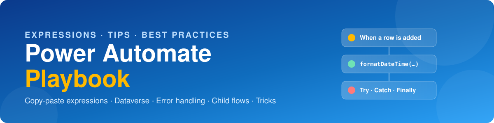

<p align="center">
  
</p>

<p align="center">
  
  
  
  
</p>

<p align="center">
  A practical field guide to <b>Microsoft Power Automate</b> cloud flows: the expressions I use every day,
  Dataverse shortcuts, error handling, parent/child flows, and tricks that save actions and API calls.
</p>

> [!TIP]
> Every snippet is copy-paste ready. Paste it into the **Expression** tab of the dynamic content panel,
> or wrap it in `@{ }` inside any text field.

---

## 📚 Guides

<table>
  <tr>
    <td width="33%" valign="top">
      <h3>🧮 <a href="docs/01-expressions-cheatsheet.md">Expressions</a></h3>
      Text, dates and time zones, numbers, arrays, null handling, conversions and run info.
    </td>
    <td width="33%" valign="top">
      <h3>🗃️ <a href="docs/02-dataverse.md">Dataverse</a></h3>
      Lookup text without <i>Get a row</i>, OData filters, setting lookups, FetchXML, trigger loops.
    </td>
    <td width="33%" valign="top">
      <h3>🛡️ <a href="docs/03-error-handling.md">Error handling</a></h3>
      Try / Catch / Finally scopes, <code>result()</code>, run links, Terminate, retry policies.
    </td>
  </tr>
  <tr>
    <td width="33%" valign="top">
      <h3>🔗 <a href="docs/04-child-flows.md">Child flows</a></h3>
      Reusable parent/child flows: inputs and outputs, fire-and-forget, returning errors.
    </td>
    <td width="33%" valign="top">
      <h3>⚡ <a href="docs/05-performance-best-practices.md">Performance</a></h3>
      Select and Filter instead of loops, concurrency, naming, solutions and ALM.
    </td>
    <td width="33%" valign="top">
      <h3>🎩 <a href="docs/06-tricks.md">Tricks</a></h3>
      Sum without a loop, de-duplicate, HTML to PDF, email attachments, trigger conditions.
    </td>
  </tr>
</table>

---

## ⭐ The 15 expressions I use most

| | Expression | What you get |
|:--|:--|:--|
|  | `formatDateTime(utcNow(), 'yyyy-MM-dd')` | Today: `2026-10-10` |
|  | `convertTimeZone(utcNow(), 'UTC', 'Pakistan Standard Time', 'dd/MM/yyyy HH:mm')` | Local time: `10/10/2026 18:30` |
|  | `addDays(utcNow(), -7)` | The date a week ago |
|  | `last(split(item()?['Email'], '@'))` | Email domain: `contoso.com` |
|  | `decodeUriComponent('%0A')` | A new line in text |
|  | `formatNumber(1234.5, 'C2', 'en-US')` | Currency: `$1,234.50` |
|  | `coalesce(item()?['Nickname'], item()?['FirstName'], 'there')` | The first value that isn't empty |
|  | `if(empty(x), 'N/A', x)` | A default for blanks |
|  | `length(body('Filter_array'))` | Number of matching items |
|  | `join(body('Select_emails'), ';')` | Array → `a@x.com;b@y.com` |
|  | `split('a,b,c', ',')` | Text → `["a","b","c"]` |
|  | `union(variables('Arr'), variables('Arr'))` | Duplicates removed |
|  | `first(outputs('List_rows')?['body/value'])?['name']` | First row, no *Apply to each* |
|  | `item()?['_ownerid_value@OData.Community.Display.V1.FormattedValue']` | Lookup **display name**, not the GUID |
|  | `concat('https://make.powerautomate.com/environments/', workflow()?['tags']?['environmentName'], '/flows/', workflow()?['name'], '/runs/', workflow()?['run']?['name'])` | A clickable **link to the current run**, for error alerts |

<p align="right"><a href="docs/01-expressions-cheatsheet.md">See the full cheat sheet →</a></p>

---

## 💡 Featured tips

> [!TIP]
> **Get a lookup's text value in *List rows*, without *Get a row***
>
> *List rows* returns a lookup as a GUID. Add `@OData.Community.Display.V1.FormattedValue` to the end of the column name to get its display text:
>
> | Column | Returns |
> |---|---|
> | `_ms_teacher_value` | Teacher's **GUID** |
> | `_ms_teacher_value@OData.Community.Display.V1.FormattedValue` | Teacher's **name** |

> [!NOTE]
> **Get the first row without an *Apply to each***
> ```text
> first(outputs('List_Academic_Session')?['body/value'])?['mb_sessionname']
> ```
> Set **Row count = 1** on *List rows*, so Dataverse returns a single row.

> [!IMPORTANT]
> **Wrap every production flow in Try / Catch.** Put the main actions in a **Try** scope and add a **Catch**
> scope that runs when Try fails. Send an alert with the error message and a run link, then **Terminate as Failed**.
> [Full pattern →](docs/03-error-handling.md)

> [!WARNING]
> **Never set variables inside a parallel *Apply to each*.** Variables are shared across iterations, so parallel
> writes overwrite each other. Use **Compose** or **Select** instead. [Why →](docs/05-performance-best-practices.md)

---

## 🏆 Golden rules

| | Rule | Why |
|:-:|---|---|
| 1️⃣ | **Rename actions first** | Expressions reference action names; renaming later breaks them |
| 2️⃣ | **Filter at the source** | OData filters and trigger conditions beat filtering inside the flow |
| 3️⃣ | **Select / Filter array over loops** | One action instead of hundreds of iterations |
| 4️⃣ | **Solutions + environment variables** | Clean moves from Dev to Test to Prod, with nothing hard-coded |
| 5️⃣ | **Try / Catch + Terminate** | Failures are reported and correctly marked as failed |

---

<p align="center">
  <sub>Maintained by <b>Muhammad Bilal</b>, Power Platform developer (Power Apps · Dataverse · Power Automate).<br>
  Found a mistake or have a trick to add? Open an issue or a pull request. ⭐ Star the repo if it helped you!</sub>
</p>
